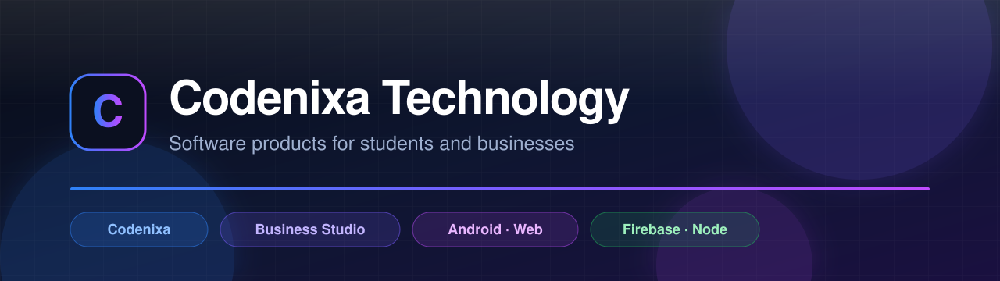
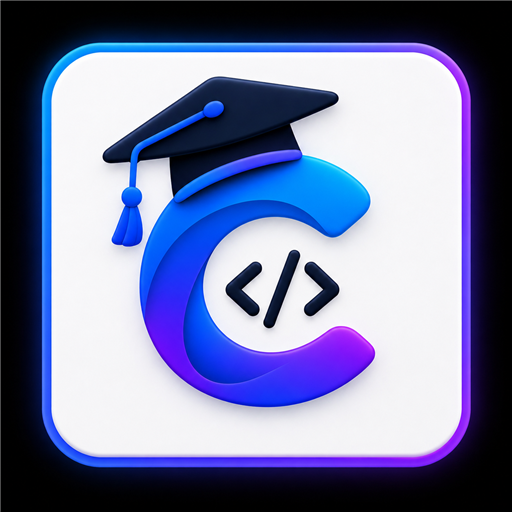

  

  

<h1 align="center">Codenixa Technology</h1>

  <b>Software products for students and businesses.</b> 
  Built in the open where it's safe — shipped privately where it matters.

  
  
  

---

## What we build

### 🎓 Codenixa

**16 focused tools in one Android app** for engineering and diploma students — academic
planning, attendance, interview practice, resume scoring, developer utilities and more.

The official website mirrors the live application: verified tool catalogue, download centre,
transparent pricing, support and legal pages. Nothing on the site is a concept mock-up.

| | |
| --- | --- |
| **Platform** | Android 8.0+ (API 26) |
| **Website** | [codenixa.web.app](https://codenixa.web.app) |
| **Focus** | Study · Career · Interviews · Development · Productivity |

### 🧰 Codenixa Business Studio

A dedicated client workspace for commissioning digital products — professional websites,
e-commerce stores, web applications and mobile apps.

Clients get a **written proposal before any work begins**, a fixed scope and price breakdown,
milestone approvals, and live project visibility from day one to handover.

| | |
| --- | --- |
| **Type** | Client project workspace |
| **Website** | [codenixa-business-studio.web.app](https://codenixa-business-studio.web.app) |
| **Focus** | Websites · E-commerce · Web apps · Mobile apps |

---

## How we work

**Transparency is the product.** Every engagement follows the same shape:

`Discover` → `Plan` → `Design & build` → `Review` → `Launch` → `Support`

- **Written scope first** — deliverables, exclusions, assumptions and schedule agreed before development starts.
- **Milestone approvals** — each milestone is presented with its files; approval is a deliberate act.
- **Clear financial records** — invoices, due dates and balances come from issued records, not estimates.
- **One conversation thread** — questions, files and decisions stay attached to the project.

---

## Engineering principles

| Principle | What it means in practice |
| --- | --- |
| **Security by default** | Credentials, service accounts and private keys never enter this organization's public repositories. |
| **Honest interfaces** | Prices, capabilities and limits are stated as they are — no invented metrics, no fake claims. |
| **Boundaries respected** | Public showcases contain presentation assets only. Product source code stays private. |
| **Verified facts** | Public documentation mirrors the real product — names, versions and plan access included. |

---

## Repository policy

This organization's **public repositories are presentation-only**.

They contain READMEs, approved logos, screenshots, feature summaries, high-level technology
names, safe public documentation and demo links — **never** original source code, `.env` files,
API keys, service accounts, database structures, internal admin panels or customer data.

Product source code lives in **private repositories** and is never made public.

---

## 📬 Contact

  
  
  

  © 2026 Codenixa Technology. All products and names are property of their respective owners.

